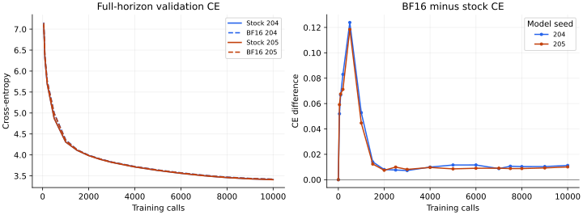
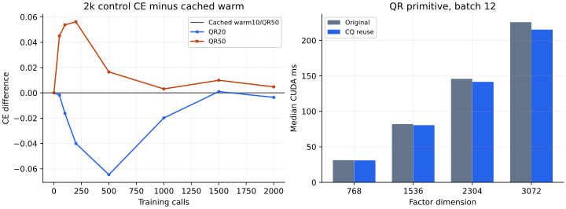

# TurboSOAP: Compiled Dense Basis Tracking with BF16 State

Working manuscript, 28 October 2026.

## Abstract

SOAP's matrix preconditioners introduce state and basis-refresh costs that can
limit its practical efficiency. We describe TurboSOAP, a dense two-sided SOAP
approximation combining damped basis tracking, periodic QR repair, BF16
persistent state, and compiled updates over equal-shaped matrices. Its precision
policy retains FP32 master parameters and decomposition islands while using
BF16 for moments, covariance factors, bases, and most matrix operands. On one
109-million-parameter language model trained on a fixed OpenWebText cohort,
two model-initialization seeds finish 10,000 optimizer calls with cross-entropy
increases of 0.01124 and 0.01008 relative to a stock-beta SOAP QR10 reference,
corresponding to 1.13% and 1.01% higher perplexity. Persistent matrix state falls
from 2.320 to 1.160 GiB. Complete-step time falls 18.66% in a paired 9,900-call
window for one seed and 17.36% in a matched 100-call prefix for the other.
Short matched-precision QR20/QR50 controls and a same-state QR profile provide
cadence and implementation context. These measurements support a scoped
quality/time/memory tradeoff; they do not establish statistical equivalence or
attribute the combined speed improvement solely to basis tracking.

## 1. Introduction

[SOAP](https://arxiv.org/abs/2409.11321v2) applies Adam-style adaptation in the
coordinate system of matrix preconditioners. Computing and maintaining that
coordinate system adds work beyond diagonal optimizers. A practical
approximation must address both its numerical history and how that history is
stored and executed on a GPU.

We investigate one concrete implementation point: full dense factors and
two-sided matrix coverage, BF16 persistent state, a fixed mixture of cheaper
dense tracking steps and periodic QR refreshes, and compilation of the complete
matrix-update regions. The objective is to document how closely this fixed
implementation follows an audited SOAP reference on an affordable language
modeling workload, together with the measured time and memory tradeoff.

The evidence has three parts. First, two initialization seeds compare the
declared 10,000-call endpoint against stock-beta QR10. Second, short full-BF16
QR20 and QR50 controls test whether intermediate tracking provides useful
learning behavior relative to simpler refresh schedules. Third, a fixed-input
profile separates redundant products in QR refinement from the solver cost.
The policy, precision rules, and source hashes remain fixed across the two
main candidate runs.

Our contribution is the specified dense tracking/repair/precision implementation
and its reproducible case study. The learning curves retain a measurable loss
gap, especially early in training. The timing comparison includes storage,
batching, arithmetic, compilation, and cadence changes relative to the original
reference. These components should remain visible when interpreting efficiency.

## 2. Relationship to existing work

Vyas et al. describe SOAP's rotated-coordinate adaptive updates and the use of
infrequent basis refinement. We retain that organizing structure and compare
against a reference using stock matrix memory settings; our model and auxiliary
optimizer recipe are specified separately. [SOAP, v2](https://arxiv.org/abs/2409.11321v2).

Milligan et al. store the basis-coordinate preconditioner and use subspace
updates, including QR within selected blocks; they also study BF16 storage.
Our implementation instead stores world-coordinate covariance factors and
updates the full basis with dense damped motion and fixed QR repair. We do not
maintain their persistent basis-coordinate representation or establish a
performance ranking against it. [Milligan et al., 2026](https://arxiv.org/html/2605.26327v1), §§3.1–3.2.

Eschenhagen et al. use approximation-error criteria to adapt eigenbasis
computation and examine the effects of stale bases. Our schedule is fixed
across factors and training stages; no residual controls refresh decisions.
Their analysis is relevant context, rather than a directly measured comparator
in this study. [Purifying Shampoo, v2](https://arxiv.org/html/2506.03595v2), §4.

Warm reuse, subspace updates, low-precision storage, and compilation are existing
ideas. The distinction studied here is their particular dense update, repair,
state-history, and precision policy. Direct comparisons with subspace or
adaptive implementations remain outside this experiment.

## 3. Method

### 3.1. State, precision, and update ordering

For a matrix parameter \(W\in\mathbb{R}^{m\times n}\), the optimizer stores
first and second moments \(M,V\), covariance factors \(C_L,C_R\), and square
bases \(Q_L,Q_R\). All six persistent tensors use BF16. Parameters, scalar age
and learning-rate tensors, pointwise moment temporaries, and decomposition
inputs/outputs before basis storage use FP32. Auxiliary parameters use the
separate AdamW optimizer described in Section 4.

Let \(R_b\) denote rounding to BF16. We distinguish two matrix products:

$$
\mathcal B(X,Y)=R_b(XY),\qquad
\mathcal F(X,Y)=\operatorname{FP32out}(XY),
$$

where both operators receive BF16 operands and use FP32 accumulation. The
notation specifies tensor rounding boundaries; it does not promise a single
GPU kernel or the absence of other temporary buffers.

On call \(k=1\), the matrix optimizer initializes zero moments, accumulates
covariances from the clipped gradient, and obtains descending initial bases by
FP32 eigendecomposition of symmetrized factors. It skips the matrix parameter
update. Auxiliary AdamW still updates on that call. For subsequent calls define
the matrix age \(t=k-1\), and let \(G_b=R_b(G)\) for the current clipped
gradient. In the existing bases,

$$
\bar G=\mathcal B(\mathcal B(Q_L^\top,G_b),Q_R),
$$

$$
M_f=\beta_1\operatorname{float}(M)+(1-\beta_1)\operatorname{float}(\bar G),
\quad
V_f=\beta_2\operatorname{float}(V)+(1-\beta_2)\operatorname{float}(\bar G)^2.
$$

The current direction uses these unrounded FP32 moment temporaries:

$$
U=\mathcal F\!\left(\mathcal B\!\left(Q_L,
 R_b\!\left[\frac{M_f}{\sqrt{V_f}+\epsilon}\right]\right),Q_R^\top\right),
\qquad
W^+=\left(W-\eta_k\frac{\sqrt{1-\beta_2^t}}{1-\beta_1^t}U\right)
 (1-\eta_k\lambda).
$$

The optimizer then stores \(R_b(M_f),R_b(V_f)\), updates the covariances,
and performs any scheduled basis change and moment transport. Thus the
direction precedes this call's basis refresh. Rounding moments before using
them for the current direction would specify a different implementation.

Covariance accumulation has one BF16 output rounding after the weighted
accumulation:

$$
C_L^+=R_b\!\left[\beta_C\operatorname{float}(C_L)
 +(1-\beta_C)G_bG_b^\top\right],
\quad
C_R^+=R_b\!\left[\beta_C\operatorname{float}(C_R)
 +(1-\beta_C)G_b^\top G_b\right].
$$

The implementation uses BF16 `baddbmm` with FP32 accumulation for this operation.
All main experiments use \(\beta_1=\beta_2=\beta_C=0.95\).

### 3.2. Dense warm tracking

For either updated covariance factor \(C\) and its current basis \(Q\), form

$$
B=\operatorname{sym}\bigl(\mathcal F(\mathcal B(Q^\top,C),Q)\bigr),
\quad d_i=B_{ii},\quad
s=\max(\max_i|d_i|,10^{-30}),\quad h_{ij}=(d_i-d_j)/s.
$$

We apply a damped skew motion in the estimated basis coordinates:

$$
A_{ij}=-\frac12\frac{B_{ij}}s\frac{h_{ij}}{h_{ij}^2+0.01^2},
\quad
a=\min\left(1,\frac{0.5}{\max(\|A\|_F/\sqrt2,10^{-12})}\right),
\quad
Y_0=R_b\bigl(\operatorname{float}(Q)+\mathcal F(Q,R_b(aA))\bigr).
$$

Two residual corrections follow:

$$
E_j=\mathcal F(Y_j^\top,Y_j)-I,\qquad
Y_{j+1}=R_b\bigl(\operatorname{float}(Y_j)
 -\tfrac12\mathcal F(Y_j,R_b(E_j))\bigr),\quad j=0,1.
$$

The stored new basis is \(Y_2\). This is an approximate orthogonality
correction, not exact QR. All products are dense: the motivation is GPU
execution and numerical policy, not a reduction in cubic asymptotic order.

### 3.3. QR repair and history transport

At positive ages divisible by 10, we refresh both factors. Ages divisible by
50 use QR repair; the remaining refresh ages use Section 3.2. For QR, cast
stored \(C,Q\) to FP32 and reuse one product:

$$
Z=\operatorname{float}(C)\operatorname{float}(Q),\quad
\pi=\operatorname{argsort}_{\downarrow}
 \left(\sum_i\operatorname{float}(Q)_{ij}Z_{ij}\right),\quad
Q^+=R_b\bigl(\operatorname{qr}(Z_{:,\pi}).Q\bigr).
$$

In exact arithmetic the sorting score equals \(\operatorname{diag}(Q^\top C Q)\),
even for nonorthogonal \(Q\). Its finite-precision evaluation can change
near-tie orderings. The existing reference instead materializes \(Q^\top C Q\)
for the diagonal and separately forms \(CQ_{:,\pi}\), using three dense
products rather than one.

After either refresh, transport the newly rounded first moment by reconstructing
its world-coordinate representation and projecting into the new bases:

$$
M^{\rm world}=\mathcal B(\mathcal B(Q_L,M),Q_R^\top),\qquad
M^+=\mathcal B(\mathcal B((Q_L^+)^\top,M^{\rm world}),Q_R^+).
$$

Here the unprimed bases are the old bases and \(M\) denotes \(R_b(M_f)\).
QR repair permutes \(R_b(V_f)\) along both axes according to the sorting
orders. Warm refresh leaves that rounded diagonal history unchanged. Neither
choice represents an exact rotation of a full second-moment tensor.

Transpose-based first-moment transport is also approximate when stored bases
are nonorthogonal. QR repair has a substantive recovery role: with
\(Q=I\) and \(C=\left[\begin{smallmatrix}1&0.5\\0.5&1\end{smallmatrix}\right]\),
all \(h_{ij}=0\), so the warm step leaves the basis unchanged despite nonzero
off-diagonal covariance. This counterexample precludes a claim that warm motion
alone always diagonalizes a factor; it does not establish incidence in training.

### 3.4. Compilation and storage

Equal-shaped parameter matrices are batched, retaining independent covariance,
basis, and moment tensors. Four groups, each containing 12 matrices, cover
shapes \(2304\times768\), \(768\times768\), \(3072\times768\), and
\(768\times1536\). Both sides of every matrix are preconditioned: 48 matrices
and 96 factors in total. There is no blocking, one-sided approximation, or
coverage change relative to the reference.

Separate full-graph compiled regions for ordinary, warm, and QR events include
packing parameters/gradients, the matrix update, covariance accumulation,
refresh/transport, and parameter writes. Initial eigendecompositions are eager.
The measured candidate captures 12 graphs without graph breaks. Compilation
preserves the explicit BF16 rounding policy; FP32 packing buffers and solver
workspaces remain possible.

Per matrix, the six persistent tensors contain
\(2mn+2m^2+2n^2\) elements. BF16 halves their tensor-byte contribution relative
to FP32, while FP32 parameters and auxiliary optimizer state remain. Total GPU
allocation therefore falls less than matrix-state storage.

## 4. Experimental design

We use a 109,396,992-parameter Transformer: width 768, 12 layers, 12 attention
heads, feed-forward hidden width 1,536, fused QKV and SwiGLU projections, tied
embeddings, RoPE, QK normalization, and no bias or dropout. Model forward uses
BF16 autocast with FlashAttention; the model is eager and FP32 cross-entropy is
compiled. Every experiment uses one RTX 5090, PyTorch 2.11.0+cu128, and CUDA
12.8 as recorded by the workers.

The cached OpenWebText corpus uses pinned dataset and GPT-2 tokenizer revisions.
Documents are split before tokenization/packing; EOS-separated packed rows use
1,024 tokens with causal attention across document boundaries. The experiment
selects 320,000 training rows and 1,024 validation rows without replacement,
then fixes their order. A global batch contains 32 rows, implemented as four
microbatches of eight; each row contributes 1,023 prediction targets. A full
run processes 327,360,000 targets over 10,000 calls. Seeds 204 and 205 change
model initialization, not data order. Evaluation uses 1,047,552 targets.

The matrix peak learning rate is 0.0015, epsilon is \(10^{-8}\), weight decay
is 0.05 for the declared decayed groups, and global gradient norm is clipped
at 1. Auxiliary AdamW uses betas (0.9, 0.999), epsilon \(10^{-8}\), peak learning
rate 0.0006, and the same declared grouping. Both rates use 200 calls of linear
warmup followed by cosine decay to 10% of peak at call 10,000. Learning-rate
selection and variant development used this research validation panel; it is
not an untouched test set.

The primary control is `ResearchSOAP` with FP32 matrix state and QR10. Its
update ordering, bias/epsilon convention, QR sorting, and variance permutation
are checked against a pinned upstream implementation. Here **stock** denotes
the matrix memory settings (0.95, 0.95, covariance 0.95), rather than a claim
to reproduce the original SOAP paper's complete training recipe.

Seed 205 runs reference and candidate sequentially on one claimed GPU. Seed
204 reuses its completed full reference for learning quality and first runs
a fresh 201-call stock replay. The replay must reproduce initial weights,
gradients, loss/norm, and validation at calls 0, 50, 100, and 200 exactly.
Each candidate repeats its initial backward and matches the paired startup.
No model or optimizer tensor checkpoints are reused or saved.

All raw results use frozen source/input hashes and record evaluations,
refresh-event counts, finite state, nonnegative variance, and graph captures.
Numerical observations cover all factors and physical moments at selected
early and late refresh ages. Evaluation checks preserve listed tensors, RNG,
and gradient identities; the tensor hash is not a claim to cover every Python
scalar or model buffer. Finite moment/Gram measurements are diagnostics rather
than validated loss-quality acceptance thresholds.

## 5. Results

### 5.1. Learning over the declared horizon

<!-- BEGIN TABLE quality -->
| Seed | Stock QR10 CE | Full BF16 CE | CE increase | Perplexity increase |
| --- | ---: | ---: | ---: | ---: |
| 204 | 3.411152 | 3.422389 | +0.011237 | +1.130% |
| 205 | 3.409272 | 3.419354 | +0.010082 | +1.013% |
<!-- END TABLE quality -->

The mean paired endpoint increase is **0.010659815 CE**. Both seeds show a
larger early gap: at call 500, BF16 exceeds the reference by 0.123913 and
0.118438 CE for seeds 204 and 205. The gap then narrows substantially. This
behavior supports reporting the full curves rather than only endpoint agreement.
Two initialization seeds with fixed data order provide limited replication;
we make no statistical equivalence claim or confidence-interval interpretation.

*Figure 1.* Left: the declared learning horizon, displaying observations from
call 50 onward. Right: BF16 minus stock CE, including the shared initial value.
Lines connect observed evaluations; they do not represent additional measurements.

### 5.2. Time and memory

<!-- BEGIN TABLE timing -->
| Seed | Matched calls | Stock step ms | BF16 step ms | Time reduction |
| --- | ---: | ---: | ---: | ---: |
| 204 | 101–200 | 380.740 | 314.638 | 17.36% |
| 205 | 101–10000 | 380.548 | 309.533 | 18.66% |
<!-- END TABLE timing -->

Seed 205's timing includes 9,900 calls, covering 198 complete 50-call cycles.
Seed 204's newly paired timing includes only calls 101–200 on the replay device;
its cached full reference is used for quality, not relabeled as newly paired
timing. These different windows should not be averaged into one speed estimate.

Persistent matrix state falls from 2,491,416,576 to 1,245,708,320 bytes
(2.320 to 1.160 GiB; approximately 50%). Seed 205's peak allocated tensor memory
falls from 9.397 to 8.223 GiB. Peak allocation includes diagnostic allocations
and is distinct from device reservation or persistent state alone.

Complete-step means include forward/backward, matrix packing and writes, and
auxiliary AdamW. Diagnostic and evaluation work is outside the timed step
scopes and inside campaign elapsed accounting. Compiler caches are shared
sequentially within campaigns. The step means do not estimate first-use
compilation cost or whole-run time-to-quality, and the combined implementation
comparison does not isolate warm tracking as the cause of all time savings.

### 5.3. Short sparse-QR controls

<!-- BEGIN TABLE controls -->
| Policy | CE at 2000 | Step ms | Optimizer ms |
| --- | ---: | ---: | ---: |
| Warm10/QR50 (cached) | 3.993939 | 314.142 | 26.415 |
| QR20 | 3.990383 | 329.641 | 40.460 |
| QR50 | 3.998679 | 313.551 | 22.864 |
<!-- END TABLE controls -->

These two fresh controls use the same full-BF16 arithmetic, coverage, efficient
QR primitive, seed 204, data, and full 10,000-call learning-rate horizon. QR20
sets both refresh and repair periods to 20; QR50 sets both to 50, producing
no warm events. The warm comparison reuses the first 2,000 calls of the completed
main candidate. Complete shared timing cycles span calls 101–2000.

At call 2000, warm is 0.003557 CE behind QR20 and 0.004740 ahead of QR50. Warm
has lower CE than QR50 at all seven noninitial validation observations; QR20
has lower CE than warm at six. These repeated panels are not independent seeds.
The warm prefix has extra refresh work for a modest quality gain over holding
bases between QR50s. Its timing comes from the earlier launch, so the small
whole-step difference from QR50 is contextual rather than a fresh paired timing
result. This study does not establish final-horizon sparse-QR superiority.

### 5.4. What QR product reuse explains

<!-- BEGIN TABLE profile -->
| Dimension (batch 12) | Original CUDA ms | Reuse CUDA ms | Time reduction | Reordered columns |
| --- | ---: | ---: | ---: | ---: |
| 768 | 31.210 | 30.914 | 0.95% | 0/9216 |
| 1536 | 82.053 | 80.535 | 1.85% | 12/18432 |
| 2304 | 145.854 | 141.566 | 2.94% | 40/27648 |
| 3072 | 225.660 | 215.218 | 4.63% | 160/36864 |
<!-- END TABLE profile -->

The profile uses identical fixed synthetic C/Q inputs within each pair,
BF16-rounded then promoted to FP32, matched FP32 high matmul precision and
FP32 QR output, without compilation or training. Two warmups precede ten
counterbalanced measurements per component using CUDA events and synchronized
wall time. Batch 12 matches the repeated-shape group size; batch-1 comparisons
are retained in the artifact.

The batched primitive saves 0.95–4.63% by reusing CQ. The solver dominates:
for dimension 3072, products/sorting fall from 18.165 to 7.724 ms, while the
same-input QR solver takes 207.613 ms. Component medians are informative,
not an additive decomposition of separately timed code.

Near ties change some column orders, reaching 160 of 36,864 columns in the
largest batch; the reordered score band is at most \(2.68\times10^{-5}\)
relative to the largest score. A synthetic one-factor BF16 transport and next
ordinary-update probe, with a fixed 32-dimensional right identity, records a
maximum physical-M difference of 0.0906% and next-update difference of 0.1116%,
with cosine at least 0.9999994. Raw stored-coordinate differences can be much
larger under signs and permutations. These observations qualify the local
comparison; they do not imply bitwise equality or trained-trajectory agreement.
We have not trained a new fully optimized FP32-QR10 comparator.

*Figure 2.* Left: QR20/QR50 CE relative to the cached warm prefix; negative values
favor the corresponding QR control. Right: original versus CQ-reuse QR primitive
medians at batch 12. This isolated profile is separate from whole-training timing.

### 5.5. Numerical observations

All sampled main-run states remain finite and candidate captures stay at 12
graphs without graph breaks. Maximum observed physical-M transport error is
0.9924% for seed 204 and 1.0356% for seed 205. Maximum normalized stored-basis
Gram error is approximately 0.002366 and 0.002367. The historical record retains
the seed-205 crossing of the 1% M screen and both candidates' crossings of the
original absolute Gram screen. These engineering screens are not calibrated
predictors of loss quality and do not define method acceptance here.

BF16-rounded bases have an orthogonality floor; normalized Gram and actual-M
observations describe different aspects of the state. Neither alone certifies
diagonalization, adaptive-direction fidelity, or convergence. The equal-diagonal
stall and approximate diagonal-V history are therefore retained as limitations
even when the sampled state remains finite.

## 6. Discussion and limitations

The measured approximation follows the reference with a modest final gap on
this workload, halves matrix-state storage, and lowers measured step time.
That result is useful as an implementation operating point. It does not show
that warm tracking, BF16 storage, or the particular repair schedule is generally
optimal. Storage and compute changes also alter numerical trajectories.

The evidence covers one model scale, one dataset cohort/order, two model
initializations, one GPU family, and a validation panel used during development.
There are no generalization claims across architectures, corpora, or hardware,
and no untouched test result or statistical equivalence test. Short QR20/QR50
controls cannot determine a final-horizon ranking. Synthetic QR inputs and
one-factor probes do not represent the trained distribution of all factor pairs.

The primary time comparison uses the original audited FP32 QR10 implementation.
Our isolated reuse profile narrows one implementation attribution question but
does not replace a newly trained efficient-reference comparison. There is no
direct matched evaluation against subspace or adaptive-refresh methods, and
the warm step has no standalone diagonalization guarantee.

## 7. Conclusion

TurboSOAP specifies and evaluates a dense BF16-state SOAP approximation with
compiled matrix updates, damped tracking, and periodic QR repair. The two-seed
case study yields a small consistent endpoint loss increase with lower matrix
state and measured step time against the declared reference. Explicit precision
and history rules, local QR attribution, and short cadence controls delimit
that tradeoff and support reproducible follow-up comparisons.

## Appendix A. Implementation-family context

An earlier five-arm 2,000-call pilot used the same seed-204 recipe and a newly
paired timing campaign. It included original stock QR10, original FP32-state
warm, a compiled FP32-storage mode with BF16 matrix arithmetic, full BF16,
and BF16 moments/covariance with FP32 bases.

<!-- BEGIN TABLE pilot -->
| Development arm | CE at 2000 | Step ms | Matrix-state GiB |
| --- | ---: | ---: | ---: |
| Stock QR10 | 3.985905 | 382.773 | 2.320 |
| Original warm, FP32 state | 3.995753 | 337.172 | 2.320 |
| Compiled FP32 storage / BF16 arithmetic | 3.991560 | 316.281 | 2.320 |
| Full BF16 | 3.993939 | 313.162 | 1.160 |
| BF16 M/V/C, FP32 bases | 3.995611 | 315.376 | 1.608 |
<!-- END TABLE pilot -->

The compiled FP32-storage mode's name describes storage, not all-FP32 arithmetic.
Switching to full BF16 changes stored bases and their associated correction
arithmetic as well as moment/covariance storage. Its roughly 0.99% lower step
time in this pilot is consequently a within-family option comparison, not a
pure storage-only causal attribution. The pilot is development evidence, not
additional independent seed replication; its shared prefix must not be counted
as a new independent full-BF16 observation.

## Appendix B. Reproducibility pointers

The repository provides the matrix-only `bf16_soap.CompiledSOAP` entry point,
frozen campaign manifests/protocols, scalar logs and audit receipts. The
[reproducibility guide](REPRODUCIBILITY.md) identifies exact configurations,
software, data revisions and hashes, CPU-only paper regeneration, and the
historical launch wrappers. The [claim map](CLAIMS.md) and machine-readable
evidence inventory connect tables and figures to their source artifacts.
Experiments save no trained model/optimizer tensor checkpoints. All reported
figures and numeric tables can be reconstructed from the scalar evidence.

## References

Nikhil Vyas, Depen Morwani, Rosie Zhao, Mujin Kwun, Itai Shapira,
David Brandfonbrener, Lucas Janson, and Sham Kakade. *SOAP: Improving and
Stabilizing Shampoo using Adam*. arXiv:2409.11321, 2024; v2, 2025.
[Paper](https://arxiv.org/abs/2409.11321v2).

Alan Milligan, Zikun Xu, Simon Lacoste-Julien, Felix Dangel, and Wu Lin.
*Reparametrizing Shampoo and SOAP for Subspace Basis Updates and BFloat16
Storage*. arXiv:2605.26327v1, 2026.
[Paper](https://arxiv.org/abs/2605.26327v1).

Runa Eschenhagen, Aaron Defazio, Tsung-Hsien Lee, Richard E. Turner, and
Hao-Jun Michael Shi. *Purifying Shampoo: Investigating Shampoo's Heuristics
by Decomposing its Preconditioner*. arXiv:2506.03595v2, 2025.
[Paper](https://arxiv.org/abs/2506.03595v2).
