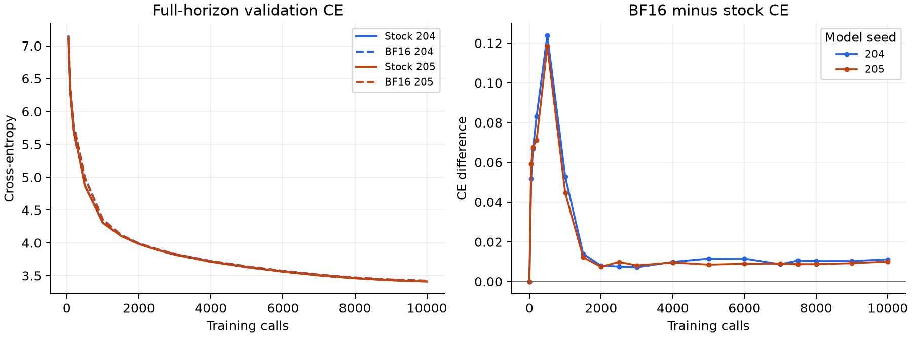
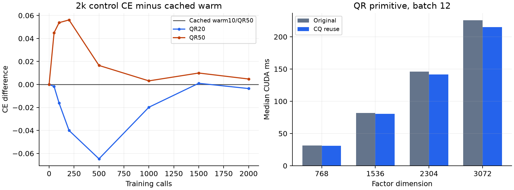

# TurboSOAP bounded demonstration: completed

The fixed compiled full-BF16 method approaches stock SOAP learning with a small
consistent final loss gap on two model seeds, while halving persistent matrix
state and reducing complete-step time against the original stock implementation.
All approved experiments and frozen measurement audits completed. The strongest
claim is a measured quality/time/memory tradeoff; these data do not establish
equivalence, general superiority, or that warm tracking alone explains speed.

## Recipe and full-horizon learning

One 109,396,992-parameter Transformer on cached OpenWebText, model seeds 204/205,
fixed data order, 10,000 optimizer calls (first matrix call initializes state),
stock matrix betas(.95,.95)/covariance.95. Same full10k LR horizon, matrix/auxiliary
peakLR.0015/.0006, decay.05, clip1, physical8 × accumulation4, 1,024-token rows,
full1,024-row validation. Full two-sided coverage:48 matrices/96 factors. BF16
M/V/C/Q and matrix arithmetic, FP32 master weights and accumulation/solver
islands; fullgraph shape batches, warm refresh10/QR repair50. See frozen protocols.

| Seed | Stock QR10 CE | Full BF16 CE | Paired CE delta | Perplexity increase |
| --- | ---: | ---: | ---: | ---: |
| 204 | 3.411151532 | 3.422388958 | +0.011237426 | +1.1301% |
| 205 | 3.409271536 | 3.419353740 | +0.010082204 | +1.0133% |

Mean paired CE delta **+0.010659815**. The peak observed
gap is at500 calls: +0.123913 / +0.118438
for204/205. Early deviation matters even though the gap shrinks late. Two model
initializations with a fixed data order are not a statistical equivalence test.
The research validation panel was used in earlier tuning; it is not untouched test data.

## Efficiency and precision

Persistent matrix state: stock2,491,416,576bytes (2.320GiB), BF161,245,708,320bytes
(1.160GiB), approximately50% less. BF16 peak allocated GPU memory8.223GiB
versus stock9.397GiB (seed205); this is allocated tensor memory, not device reservation.

Seed204 uses a newly matched100-call window101..200: stock380.740ms versus
BF16314.638ms, **17.36% less complete-step time**. Its 201-call stock replay
exactly reproduces the cached full control at0/50/100/200. Seed205 has a newly
paired9,900-call window101..10000: stock380.548ms versus BF16309.533ms,
**18.66% less time**. Keep those window scopes separate; do not average them.
Timed steps include packing, casts, parameter writes and auxiliary AdamW.
Startup, evaluation and diagnostics are excluded from step means but included
in campaign elapsed and execution caps. Compilation/storage/batching/cadence
change together relative to original stock; no single-kernel causal attribution.

All sampled state is finite; candidate captures remain12 graphs, no breaks.
Seed204/205 max actual-M errors .9924%/1.0356%, normalized Gram~.002366/.002367.
Seed205 crosses the historical1% M screen; both cross the original absolute
Gram screen. Raw flags remain unchanged. Under current user steering these
finite measurements are diagnostics, not loss acceptance thresholds. Diagonal-V
transport and M preservation are approximate; small Gram/M errors do not
certify covariance alignment.

## Short cadence controls

Two fresh full-BF16 pure-QR arms, seed204,2,000 calls each, unchanged10k LR
horizon; compare with cached warm prefix. Same initialization/gradients/full
validation, precision/coverage and CQ-reuse QR. Only cadence changes.

| Policy | CE at2000 | Step ms | Optimizer ms |
| --- | ---: | ---: | ---: |
| Warm10/QR50 (cached) | 3.993939314 | 314.142 | 26.415 |
| qr20 | 3.990382792 | 329.641 | 40.460 |
| qr50 | 3.998679463 | 313.551 | 22.864 |

Complete shared100-call cycles101..2000 (1,900 calls). QR20/QR50 are sequential
new timings on one device; warm timing is cached across launches. Warm is
.003557 CE behind QR20 and .004740 ahead of QR50 at the endpoint, better than
QR50 at all seven noninitial observations. QR20 is better at six of seven.
The modest warm-versus-hold quality gain has extra work; its tiny observed
whole-step difference from QR50 is not a precise newly paired timing result.
These are single-seed early-prefix observations, not final-horizon superiority.

QR20 totals cold1/ordinary1900/QR99, QR50 cold1/ordinary1960/QR39, no warm events.
Both maintain eight training graphs without breaks and final finite model,
matrix and auxiliary state. Max actual-M errors .5499%/.5105% are diagnostics.

## Same-state QR attribution

Fixed synthetic C/Q at existing dimensions, BF16-rounded then promoted to FP32;
both original and CQ reuse use identical FP32 high matmul precision and FP32 QR
outputs/solver. No compilation or training. Two warmups/ten counterbalanced
rounds, CUDA and synchronized wall samples. Original uses three dense products,
reuse one. Batch12 matches real shape groups; pair comparisons keep batch fixed.

| Batch | Dimension | Original CUDA ms | Reuse CUDA ms | Time reduction | Reordered columns |
| ---: | ---: | ---: | ---: | ---: | ---: |
| 1 | 768 | 3.051 | 2.832 | 7.19% | 0/768 |
| 1 | 1536 | 7.228 | 6.933 | 4.08% | 0/1536 |
| 1 | 2304 | 12.369 | 11.958 | 3.33% | 2/2304 |
| 1 | 3072 | 19.247 | 18.060 | 6.16% | 10/3072 |
| 12 | 768 | 31.210 | 30.914 | 0.95% | 0/9216 |
| 12 | 1536 | 82.053 | 80.535 | 1.85% | 12/18432 |
| 12 | 2304 | 145.854 | 141.566 | 2.94% | 40/27648 |
| 12 | 3072 | 225.660 | 215.218 | 4.63% | 160/36864 |

At batch12, reuse saves0.95–4.63% of this primitive, as QR solver time dominates.
Products/sort alone improve more; all component samples are in the scalar
evidence. Component medians are not an additive decomposition. Batching,
precision, compilation and full optimizer timing are distinct questions.

Near-tie score bands reach2.68e-5 of max score; normalized FP32-output Gram is
at most1.19e-6. Raw basis and coordinate-M differences are large under sign/
ordering changes (coordinate-M relative difference up to.877); sign-aligned
basis difference reaches.0932 and V-coordinate difference.0404. Those raw
coordinate comparisons are not physical update errors. Max physical-M relative
difference is.0009064 and next ordinary-update relative difference.0011161
(~.112%), cosine at least.9999994. This is a synthetic one-factor probe with
a fixed32D right identity using actual BF16 transport/ordinary kernels. It
does not establish bitwise equivalence, exact state transport or trained
trajectory agreement. Input hashes, finite state and nonnegative V checks pass.
Current training speed claims continue to name the original stock control;
there is no newly trained efficient-FP32-QR10 comparator.

## Scope, provenance and stopping point

No production optimizer change. Production source pins match the ledger; frozen
source/input/support/event/replay/evaluation/capture audits passed. Controls had
17 CPU checks; profile had4 against independent float64 and actual reference/
production primitives. Controls/profile supervised wall time (including any
queue/startup) totaled1,500seconds, an upper bound on added claimed GPU execution;
their hard execution caps reserve1,800+600seconds, below2,700 authorized seconds.
No retries, additional full runs, sweeps, new datasets or tensor checkpoints.

Broad warm reuse, partial-basis methods and BF16 storage overlap prior work.
See the completed [novelty review](../review_20261026/REVIEW_SYNTHESIS.md).
A paper can center the specific dense kernel/precision policy and this modest
approximation tradeoff. General optimizer superiority and novelty of warm
tracking or BF16 storage are not established. The bounded demonstration is
complete; drafting can use these results without adding a benchmark suite.

Reproduce this report on CPU with benchmarks/summarize_bf16_completion.py.
[Summary and input SHA256 provenance](summary.json), exportable PNG/SVG figures,
[replication review](../bf16_replicate_20261027_seed204/REVIEW.md),
[controls](../bf16_refresh_controls_20261027/REVIEW.md),
[QR profile](../bf16_qr_attribution_20261027/result.json). Historical evidence
and frozen protocols remain unchanged. The completion monitor is disabled
after saving the final ledger and backup; no GPU work remains in this plan.
